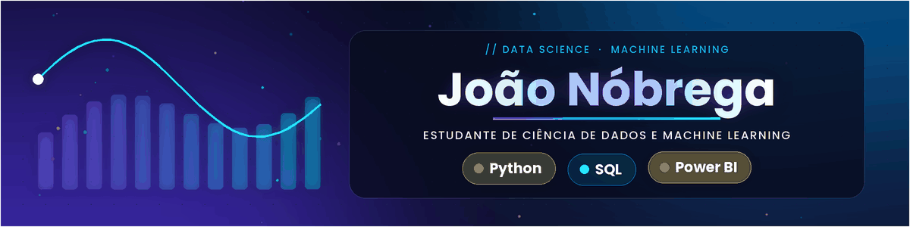

#

  

</h3>

#

Atualmente sou estudante de Ciência de Dados e Machine Learning. Tenho grande interesse em dados e busco aprender cada vez mais para desenvolver minhas habilidades. Sou uma pessoa dedicada, responsável e comprometida com aquilo que faço. Procuro aproveitar as oportunidades para aprender, evoluir e me desenvolver, tanto profissionalmente quanto pessoalmente.

#

  
  
  

#

 

<picture data-importer="pacman">
  <source media="(prefers-color-scheme: dark)" srcset="https://raw.githubusercontent.com/nobrregaa-dados/nobrregaa-dados/pacman-output/pacman-contribution-graph-dark.svg?game=pacman">
  <source media="(prefers-color-scheme: light)" srcset="https://raw.githubusercontent.com/nobrregaa-dados/nobrregaa-dados/pacman-output/pacman-contribution-graph.svg?game=pacman">
  
</picture>

#

###

<i>"A tecnologia move o mundo?"</i> 

